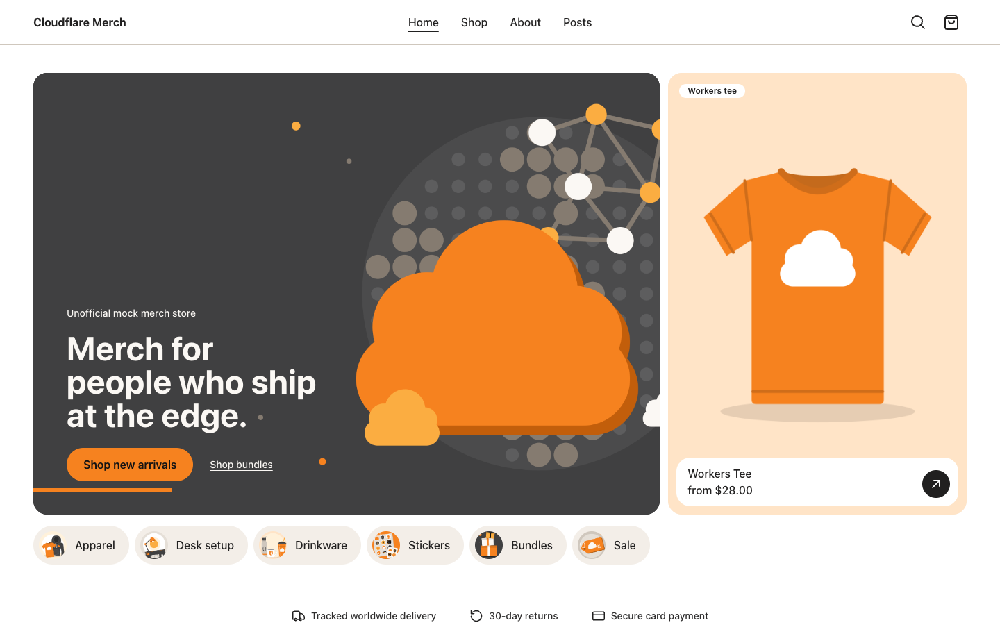
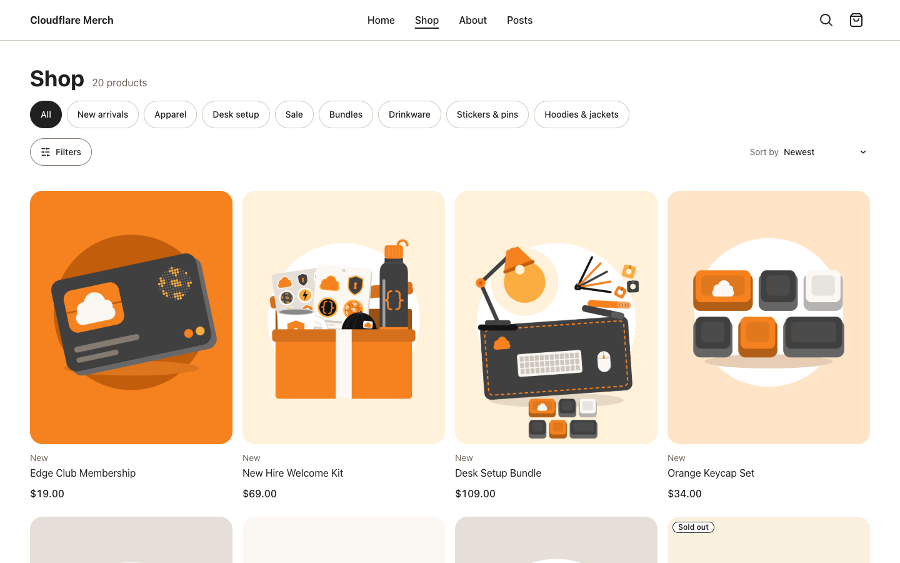
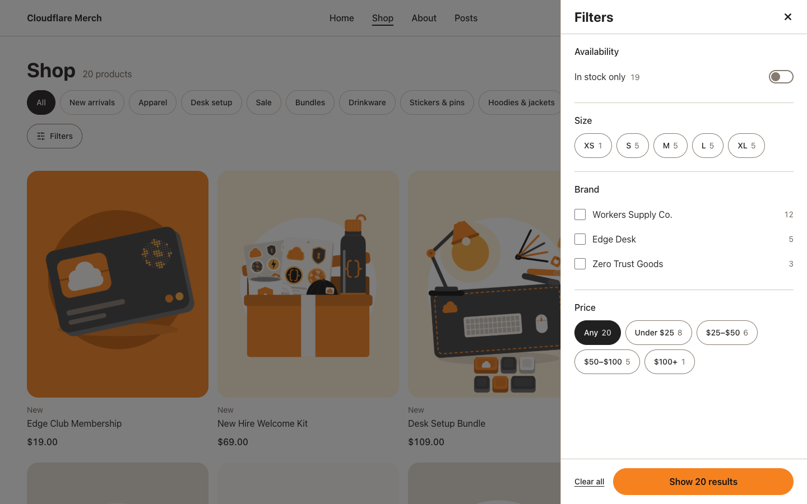
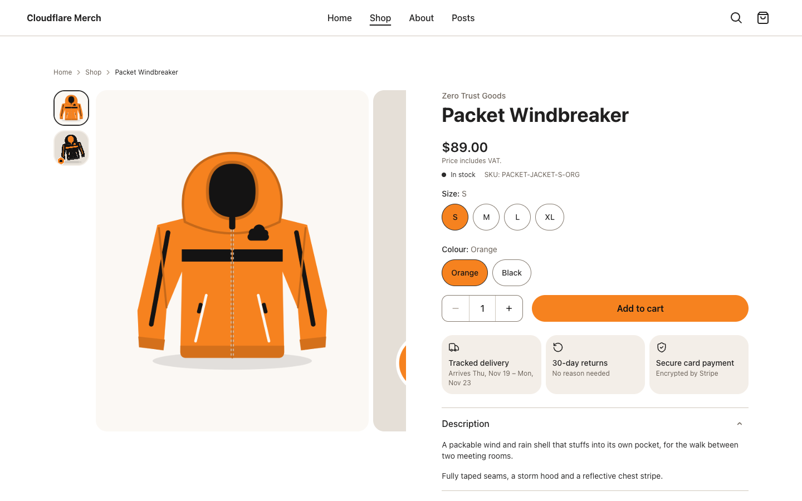
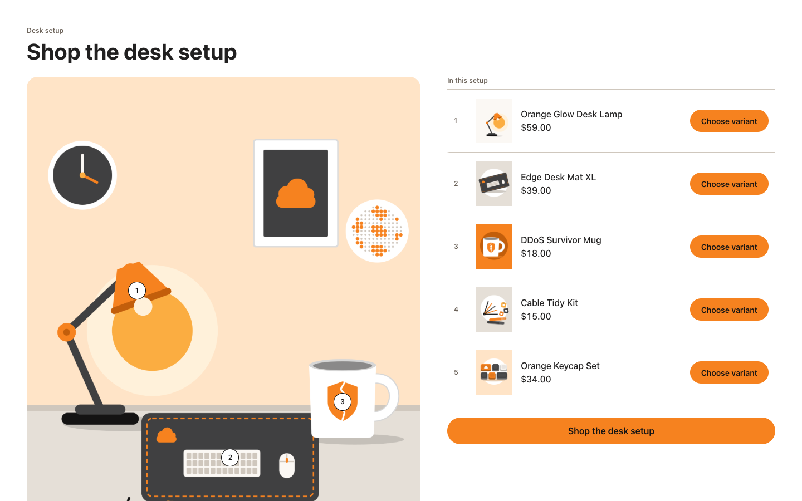

# emdash-commerce

Commerce for [EmDash](https://github.com/emdash-cms/emdash) (the Astro-based CMS): a Stripe plugin, an image-with-points
field widget, a Cloudflare-orange design system, and a demo storefront that uses all three. One Nx + pnpm monorepo.

The demo shop is an **unofficial mock Cloudflare-merch store**: fictional products (tees, a windbreaker, desk gear, mugs,
stickers, bundles and a membership), generated art, USD prices, Stripe **sandbox** only. It is not affiliated with
Cloudflare, nothing is for sale and nothing ships. The theme is data, so the same code runs any other shop.



**New here? Two ways in:**

- **With an AI agent** (Claude Code, Codex, Cursor): open this repo in it and paste the prompt below, or read
  [docs/ai-guide.md](docs/ai-guide.md), which has the architecture map, what you can build and a prompt for each job.
- **By hand:** [docs/getting-started.md](docs/getting-started.md), from a fresh clone to a test purchase in the admin.

```text
You are in the emdash-commerce monorepo. Read AGENTS.md, .ai/README.md, .ai/memory/MEMORY.md and docs/ai-guide.md.
Then explain in under 40 lines what this project is, how a request travels from the browser to Stripe and back, and
which commands and invariants matter. Do not change anything. Ask me what I want to build, and plan before you edit.
Rules: Stripe sandbox keys only, never print a secret, do not commit unless I ask.
```

| Path | Package | What |
|---|---|---|
| `apps/storefront` | `@emdash-commerce/storefront` | The demo shop: Astro 7 SSR on EmDash (Node + SQLite + local uploads). Home, shop, product page, cart, Stripe Checkout. |
| `packages/plugin-stripe` | `@emdash-commerce/plugin-stripe` | Backend-only commerce plugin (id `stripe-commerce`): catalog with variants and prices mirrored to Stripe, carts, Checkout Sessions, orders, refunds, disputes, subscriptions, a durable webhook pipeline. [README](packages/plugin-stripe/README.md) |
| `packages/plugin-image-hotspots` | `@emdash-commerce/plugin-image-hotspots` | React field widget `image-hotspots:hotspots`: an image with points (a product per point, or a title and text). [README](packages/plugin-image-hotspots/README.md) |
| `packages/design-system` | `@emdash-commerce/design-system` | Tokens (orange on warm charcoal) and props-driven Astro components: flat, soft corners, no shadows or gradients, no brand assets. [README](packages/design-system/README.md) |

Plugin ids (`stripe-commerce`, `image-hotspots`) and the widget reference (`image-hotspots:hotspots`) are stored in content
and schema, so they are part of the contract.

## Features

**Storefront** (Astro 7, server-rendered; English or Polish copy, chosen per deployment by the site's default locale)

- **Shop listing:** a category bar, sort, and a filter drawer (a full-screen sheet on a phone) with in stock, size, brand
  (multi-select) and price presets. Every option shows its result count and the "Show N results" button updates live;
  applied filters are removable chips, the state lives in the URL, and the panel still works without JavaScript.
- **Product pages:** size x colour variants with their own price, photos and stock; colour swaps the gallery; sold-out and
  low-stock states; a delivery estimate, returns and payment promises beside the button; accordions for details; an
  "Adding... / Added" button, a mini-cart and a sticky buy bar on a phone.
- **Bundles and membership:** a fixed-price bundle lists what it includes and the saving ("$109 instead of $147"); a
  membership has a recurring price with a trial.
- **Shop the look:** a photo with numbered points; each point opens a product and one dialog adds the whole kit to the cart.
- **Your order:** the signed link in the order emails opens `/orders/view`: order number, payment and fulfilment status, a
  progress track, lines and totals. The page is never cached or indexed and sends no referrer, because the token is a secret.
- **Category and brand URLs:** `/shop/c/<slug>` and `/shop/brand/<slug>` (the URLs the plugin gives those collections) lead to
  the filtered shop; an unknown slug is a real 404.
- **Home, cart, search and a blog:** hero with category pills, rails, a spotlight with callouts, FAQ and newsletter; cart and
  Stripe-hosted Checkout; full-text search; posts, tags and RSS from the EmDash blog template.

**Commerce backend** (`stripe-commerce` plugin)

- A catalog of products, variants and prices, mirrored to Stripe; carts whose amounts are derived on the server (the browser
  sends price ids and quantities only).
- Checkout Sessions, a durable webhook pipeline (a paid order is created exactly once), refunds, disputes, subscriptions,
  inventory with stock reservation while a checkout is open, and guest order links.
- An admin **Commerce** page (key and webhook health, resync, reconcile, abandoned-checkout cleanup) and 19 MCP tools so an
  agent can run the same operations.
- Plugin options the demo shop leaves **off**: promotion codes, fixed shipping rates, Stripe Tax and embedded Checkout (see
  the plugin README, "Options"). Order emails need an EmDash email provider.

**Admin** (EmDash)

- Edit products, categories, brands, pages, posts and the home page in the EmDash admin.
- **Image-hotspots widget:** pick a photo, click it to add points, drag or arrow-key them, and choose a product (or write a
  title and text) for each one.

**Design system**

- Tokens (Cloudflare orange on warm charcoal, soft corners) and props-driven Astro components; the storefront only shapes data
  into props.
- Lints that fail on a raw colour, a shadow or a gradient, and a test of the token text and control colour pairs against WCAG contrast.
- The package holds more components than the demo uses (account, reviews, returns, events and others); only what the
  storefront renders is a feature of the shop.

**Built to be driven by people and AI agents**

- `pnpm bootstrap` and `pnpm doctor` set up and check a fresh clone; `pnpm seed` is idempotent and builds the whole mock
  catalog (generated PNG art, no network); `pnpm art` redraws the art.
- [`AGENTS.md`](AGENTS.md), [`docs/ai-guide.md`](docs/ai-guide.md) (architecture map and a prompt per job) and the `.ai/`
  folder (decisions, memory, run logs) let an agent start from a prompt and keep the record up to date.

## Screenshots

The mock Cloudflare-merch shop with the seeded data, light theme. Product art is generated by `scripts/art/`.

| | |
|---|---|
|  |  |
| **Shop:** category bar, sort and a borderless product grid | **Filters:** a drawer with live counts and "Show N results" |
|  |  |
| **Product page:** variants, promises beside the button, accordions | **Bundle:** what it includes and what you save |
|  |  |
| **Shop the look:** a point per product, one button for the kit | **Admin:** the image-hotspots widget on the home page |

On a phone (390 px wide): the shop, the full-screen filter sheet and a product page.


## Quickstart

**Full walkthrough: [docs/getting-started.md](docs/getting-started.md)** (prerequisites, Stripe sandbox keys, every
environment variable, the webhook secret, seeding, the admin login, resetting, troubleshooting). The short version, with
Node >= 24.22.1 (`.node-version`), pnpm 10 and the [Stripe CLI](https://docs.stripe.com/stripe-cli) installed and logged in:

```bash
pnpm install
pnpm bootstrap     # creates apps/storefront/.env, generates the encryption key, asks for your Stripe SANDBOX key,
                   # reads the webhook secret from the Stripe CLI, prints the next steps (a live key is refused)
pnpm dev           # terminal 1: http://localhost:4360
stripe listen --forward-to localhost:4360/_emdash/api/plugins/stripe-commerce/webhook   # terminal 2
pnpm seed          # the mock catalog, the Homepage fields, and the Stripe catalog sync
pnpm doctor        # read-only check: toolchain, .env, dev server, seeded catalog
```

After the very first seed on an empty database restart the server once (`npx astro dev stop` in `apps/storefront`, then
`pnpm dev`): EmDash reads the site URL at startup and checkout needs it.

Open <http://localhost:4360/shop>, add a product and pay with test card `4242 4242 4242 4242`. The admin is at
`/_emdash/admin`; sign in once with `http://localhost:4360/_emdash/api/setup/dev-bypass?redirect=/_emdash/admin`.
Reset by stopping the server and deleting `apps/storefront/data.db*` and `apps/storefront/uploads/`.

EmDash keeps its schema (collections and fields) and content in the database, not in the repo
(`.ai/memory/emdash-schema-lives-in-the-database.md`): the schema comes from `apps/storefront/seed/seed.json` through the
dev login and the commerce collections are created by the `stripe-commerce` plugin when the server starts. `pnpm seed`
(`scripts/seed-demo.mjs`, dependency-free and idempotent) adds the catalog from `scripts/lib/merch-catalog.mjs` and the
Homepage fields, then queues the plugin's catalog resync and waits until Stripe has the products (sandbox key only; without
a key it says what to run later). `EMDASH_URL` points it at another port. The product photos are committed mock art in
`apps/storefront/public/merch/`, drawn by `scripts/art/` (`pnpm art`), so no network is needed.

## Commands

| Command | Does |
|---|---|
| `pnpm dev` | Storefront dev server (port 4360) |
| `pnpm bootstrap` | First-run setup of `.env` (idempotent, never prints a secret, refuses a live Stripe key) |
| `pnpm doctor` | Read-only check of the toolchain, `.env`, the dev server and the seeded catalog |
| `pnpm seed` | Mock catalog and Homepage fields (dev server must run) |
| `pnpm art` | Regenerates the mock product art into `apps/storefront/public/merch/` |
| `pnpm typecheck` · `pnpm test` · `pnpm build` | The validation gate (`nx run-many`) |
| `pnpm check:ai` | Validates the `.ai/` layout, file names and memory index |

Astro 7's `astro dev` detaches: stop it with `npx astro dev stop` inside `apps/storefront`.

## For agents

[`AGENTS.md`](AGENTS.md) is the map; [`docs/ai-guide.md`](docs/ai-guide.md) is the memo with the architecture and prompts;
`.ai/README.md` describes the changelog, decisions, run logs and memory.

Cloudflare and its marks belong to Cloudflare, Inc. This project is an independent demo and is neither endorsed by nor
affiliated with it.

## License

[MIT](LICENSE)
