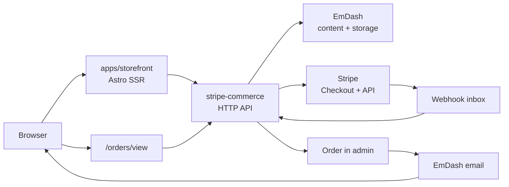
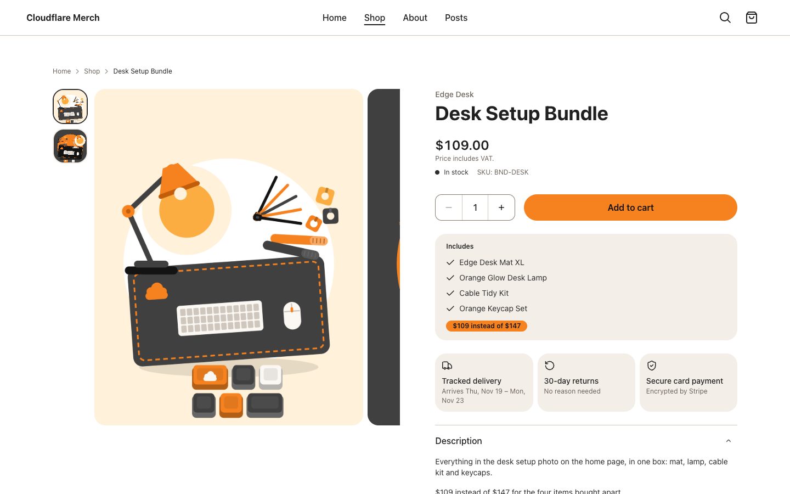
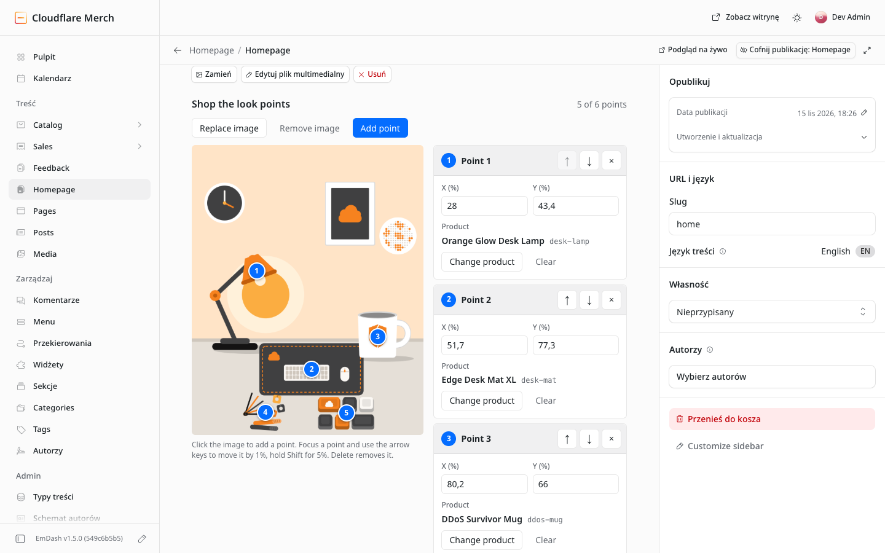
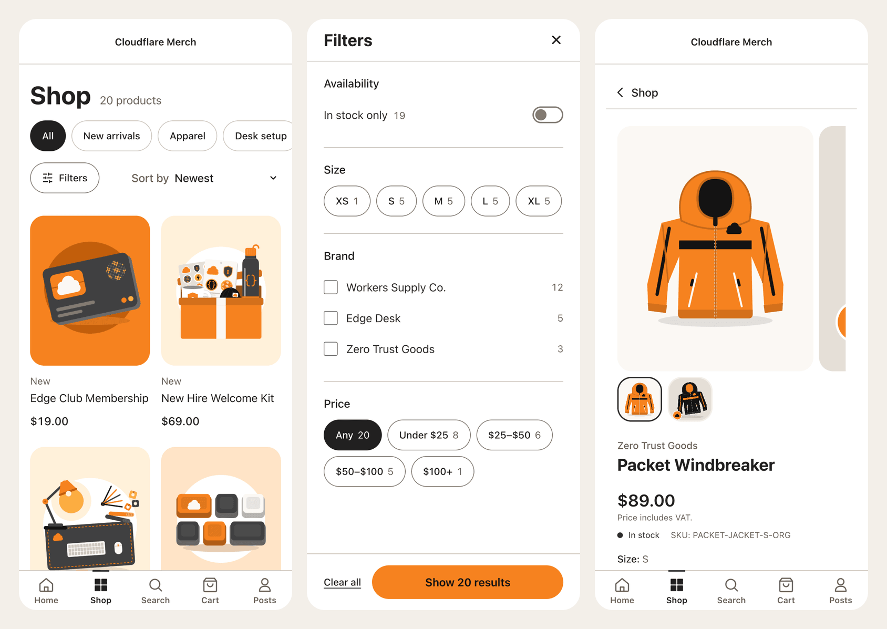

# emdash-commerce

[](https://github.com/zawoj/emdash-commerce/actions/workflows/ci.yml)
[](LICENSE)

Commerce for [EmDash](https://github.com/emdash-cms/emdash) (the Astro-based CMS): a Stripe plugin, an image-with-points
field widget, a design system, and a demo storefront — one Nx + pnpm monorepo.

> **Community project, not official.** This repository (`zawoj/emdash-commerce`, MIT) is maintained for the EmDash
> community. It is **not** an official [EmDash](https://github.com/emdash-cms/emdash) or
> [Cloudflare](https://www.cloudflare.com/) product, and neither endorses it. The demo is an **unofficial mock
> Cloudflare-merch store**: fictional products, generated art, USD prices, Stripe **sandbox** only — nothing ships and
> nothing is for sale. You may re-theme the catalog; keep any disclaimer honest.


**New here?**

- **With an AI agent:** read [`AGENTS.md`](AGENTS.md), [`docs/ai-guide.md`](docs/ai-guide.md), and root [`skills/`](skills/README.md);
  paste the prompt from the AI guide.
- **By hand:** [`docs/getting-started.md`](docs/getting-started.md) — clone to a test purchase.

```text
You are in the emdash-commerce monorepo. Read AGENTS.md, .ai/README.md, .ai/memory/MEMORY.md and docs/ai-guide.md.
Then explain in under 40 lines what this project is, how a request travels from the browser to Stripe and back, and
which commands and invariants matter. Do not change anything. Ask me what I want to build, and plan before you edit.
Rules: Stripe sandbox keys only, never print a secret, do not commit unless I ask.
```

## Get started

Node **>= 24.22.1** (`.node-version`), pnpm **10**, [Stripe CLI](https://docs.stripe.com/stripe-cli) for local webhooks.
Full walkthrough: **[`docs/getting-started.md`](docs/getting-started.md)**.

```bash
pnpm install
pnpm bootstrap     # creates apps/storefront/.env, generates EMDASH_ENCRYPTION_KEY (emdash_enc_v1_…), asks for a
                   # Stripe SANDBOX key, reads webhook secret from the CLI, refuses a live key
pnpm dev           # http://localhost:4360
stripe listen --forward-to localhost:4360/_emdash/api/plugins/stripe-commerce/webhook   # second terminal
pnpm seed          # mock catalog, Homepage fields, Stripe catalog sync when a key is set
pnpm doctor        # read-only health check
```

After the **first seed on an empty database**, restart the server once (`npx astro dev stop` in `apps/storefront`, then
`pnpm dev`) — EmDash reads the site URL at startup and checkout needs it.

Admin (dev only): `http://localhost:4360/_emdash/api/setup/dev-bypass?redirect=/_emdash/admin`.

## Deploy

| Target | Guide |
| --- | --- |
| **Cloudflare** (Workers + D1 + R2) | [`docs/cloudflare.md`](docs/cloudflare.md) — `DEPLOY_TARGET=cloudflare`, `dev:cloudflare`, `deploy:cloudflare` |
| **Production habits** (export/import, webhooks, email) | [`docs/production.md`](docs/production.md) |

**Deploy to Cloudflare button:** it **does not work** for this monorepo as-is. Cloudflare treats a URL subdirectory as
the repo root; `apps/storefront` depends on sibling workspace packages (`workspace:*`), so a one-click clone cannot
resolve them. Use **Workers Builds** with the repository root and build directory `apps/storefront`, or publish
`@emdash-commerce/*` to npm first — see [`docs/cloudflare.md`](docs/cloudflare.md) and
`.ai/memory/cloudflare-deploy-button-needs-an-isolated-subdirectory.md`.

## How it works



## Features

**Storefront** (Astro 7, SSR; English or Polish copy per deployment default locale)

- Shop listing with category bar, sort, filter drawer (URL state, works without JS), live counts.
- Product pages: variant grid, gallery, stock states, bundles and membership, shop-the-look hotspots.
- **Cart** and **checkout success** pages built from the design system (`/cart`, `/checkout/success`).
- **Guest orders:** signed link in mail → `/orders/view`; request a new link → `/orders/lookup`.
- Category and brand URLs: `/shop/c/<slug>`, `/shop/brand/<slug>` → filtered shop (unknown slug → 404).
- Home, search, blog (posts, tags, RSS) on the EmDash blog template.
- Second runtime target: **Cloudflare** (`docs/cloudflare.md`).
- **Tests:** Vitest unit and integration tests across packages, and a **Playwright** suite (`pnpm test:e2e:smoke` runs in CI on
  every PR without secrets; `pnpm test:e2e` adds a real Stripe-sandbox purchase, run weekly and on demand) — see
  [docs/testing.md](docs/testing.md).

**Commerce backend** (`stripe-commerce` plugin)

- Catalog (variants, prices, brands, categories), server-priced carts, Stripe Checkout, webhook pipeline (paid order
  exactly once), refunds, disputes, subscriptions, inventory reservation, guest order links.
- Admin **Commerce** page and **19 MCP tools**.
- Demo leaves **off:** promotion codes, shipping rates, Stripe Tax, embedded Checkout (plugin README, "Options").

**Admin** — EmDash CMS; **image-hotspots** widget for shop-the-look points.

**Design system** — tokens (Cloudflare-orange wireframe), props-driven Astro components, `token-lint` / `wireframe-lint`.

**Tooling** — `pnpm bootstrap`, `pnpm doctor`, `pnpm seed`, `pnpm art`, **oxlint** (`pnpm lint`), **Changesets**
(`pnpm changeset`, `docs/releasing.md`), CI on every PR, `AGENTS.md`, `docs/ai-guide.md`, `.ai/`, root **`skills/`**.

## Packages

| Path | npm (once published) | Role |
| --- | --- | --- |
| `apps/storefront` | *(private demo)* | Mock shop on EmDash (Node + SQLite or Cloudflare) |
| `packages/plugin-stripe` | `pnpm add @emdash-commerce/plugin-stripe` | `stripe-commerce` backend |
| `packages/plugin-image-hotspots` | `pnpm add @emdash-commerce/plugin-image-hotspots` | `image-hotspots:hotspots` widget |
| `packages/design-system` | `pnpm add @emdash-commerce/design-system` | Storefront UI components and tokens |

Nothing under `@emdash-commerce` is on npm yet — see [`docs/releasing.md`](docs/releasing.md). In this monorepo, the
storefront consumes them via `workspace:*`.

Plugin ids `stripe-commerce` and `image-hotspots` and widget ref `image-hotspots:hotspots` are stored in content: **do
not rename**.

## Screenshots

Mock Cloudflare-merch shop with seeded data (art from `scripts/art/`).

| | |
|---|---|
|  |  |
|  |  |
|  |  |



## Documentation

### Repo docs

| File | Topic |
| --- | --- |
| [`docs/getting-started.md`](docs/getting-started.md) | Prerequisites, `.env`, webhooks, seed, purchase, reset |
| [`docs/ai-guide.md`](docs/ai-guide.md) | Architecture map, prompts for agents |
| [`docs/production.md`](docs/production.md) | Export/import, production webhooks and email |
| [`docs/cloudflare.md`](docs/cloudflare.md) | Workers, D1, R2, deploy limits, what was verified |
| [`docs/releasing.md`](docs/releasing.md) | Changesets and npm publish |

### Package docs

| File | Topic |
| --- | --- |
| [`packages/plugin-stripe/README.md`](packages/plugin-stripe/README.md) | Install, options, MCP, limitations |
| [`packages/plugin-stripe/docs/architecture.md`](packages/plugin-stripe/docs/architecture.md) | Layers and data ownership |
| [`packages/plugin-stripe/docs/api.md`](packages/plugin-stripe/docs/api.md) | HTTP API and errors |
| [`packages/plugin-stripe/docs/extending.md`](packages/plugin-stripe/docs/extending.md) | Subscribers and site entrypoints |
| [`packages/plugin-image-hotspots/README.md`](packages/plugin-image-hotspots/README.md) | Hotspots widget |
| [`packages/design-system/README.md`](packages/design-system/README.md) | Tokens and conventions |

### Decisions and agent records

| Path | Topic |
| --- | --- |
| [`.ai/decisions/`](.ai/decisions/) | ADRs (architecture, catalog v2, Cloudflare, Changesets, community conventions, …) |
| [`.ai/memory/MEMORY.md`](.ai/memory/MEMORY.md) | Traps and lessons index |
| [`.ai/runs/`](.ai/runs/) | Autonomous run logs |
| [`ROADMAP.md`](ROADMAP.md) | Forward-looking plan (exception to “docs = actual state”) |

### Agent skills

| Skill | Path |
| --- | --- |
| Building a commerce site | [`skills/building-commerce-site/SKILL.md`](skills/building-commerce-site/SKILL.md) |
| Extending the Stripe plugin | [`skills/extending-stripe-plugin/SKILL.md`](skills/extending-stripe-plugin/SKILL.md) |
| EmDash core (vendored in storefront) | `apps/storefront/.agents/skills/` |

## Commands

| Command | Does |
| --- | --- |
| `pnpm dev` | Storefront on port **4360** |
| `pnpm bootstrap` · `pnpm doctor` | First-run `.env` · health check |
| `pnpm seed` · `pnpm art` | Demo catalog · regenerate product PNGs |
| `pnpm lint` | oxlint (zero errors in CI) |
| `pnpm changeset` | Add a changeset when a publishable package changes |
| `pnpm check:ai` | `.ai/` layout and memory index |
| `pnpm typecheck` · `pnpm test` · `pnpm build` | Validation gate |
| `pnpm test:e2e:install` · `pnpm test:e2e:smoke` · `pnpm test:e2e` | Chromium for Playwright (once) · browser tests, no secrets · plus a real sandbox purchase (Stripe key and Stripe CLI) |

Cloudflare (from repo root): `pnpm --filter @emdash-commerce/storefront dev:cloudflare --port 4361` (use a port other
than 4360 if the Node dev server runs). Stop detached Astro with `npx astro dev stop` in `apps/storefront`.

## Contributing · Security · Conduct · Releasing

- [`CONTRIBUTING.md`](CONTRIBUTING.md) — setup, gates, PR rules
- [`SECURITY.md`](SECURITY.md) — report vulnerabilities via GitHub Security Advisories
- [`CODE_OF_CONDUCT.md`](CODE_OF_CONDUCT.md) — Contributor Covenant 2.1
- [`docs/releasing.md`](docs/releasing.md) — Changesets and `@emdash-commerce` on npm
- [`docs/testing.md`](docs/testing.md) — unit, lint, and end-to-end tests

## Built for agents

[`AGENTS.md`](AGENTS.md) is the map. [`docs/ai-guide.md`](docs/ai-guide.md) lists architecture and copy-paste prompts.
[`skills/`](skills/README.md) teach commerce-specific tasks; EmDash's own skills ship under
`apps/storefront/.agents/skills/`. Record changes in [`CHANGELOG.md`](CHANGELOG.md) and `.ai/` per [`.ai/README.md`](.ai/README.md).

## Roadmap

What we intend to do next, and what this demo deliberately leaves out, is in [`ROADMAP.md`](ROADMAP.md) — the only place in
the repo for plans (no dates, no promises). Next up: one-click Deploy to Cloudflare, production seeding, the first npm
release under `@emdash-commerce`, email on deployed sites, and Playwright e2e on the Cloudflare target. Want to help? See
[`CONTRIBUTING.md`](CONTRIBUTING.md) and open a [Discussion](https://github.com/zawoj/emdash-commerce/discussions).

### Limits today

From the plugin and demo scope — not a bug list for drive-by fixes:

- **No customer accounts** — guest email + signed order links only.
- **Guest cannot get an order link from checkout UI alone** — use **`/orders/lookup`** (or the email link).
- **One currency per cart**; no multi-currency cart or FX in the demo.
- **No digital downloads**; fulfilment is a status field (no labels or tracking).
- **Shipping, tax, promo codes, embedded Checkout** — plugin options the demo leaves off.
- **`pnpm seed` needs the dev login** — not for production deploys; use admin, MCP, or site import + catalog resync.
- **Deploy button** cannot build this monorepo subdirectory without a standalone copy or published packages.
- **E2E covers the Node target only** — the Cloudflare target is verified by hand (see [docs/cloudflare.md](docs/cloudflare.md)), not by Playwright.
- See also **`packages/plugin-stripe/README.md` § Limitations** and **`docs/ai-guide.md` § Not built**.

## Trademarks

Cloudflare and its marks are trademarks of Cloudflare, Inc. This project is independent and unaffiliated.

## License

[MIT](LICENSE)